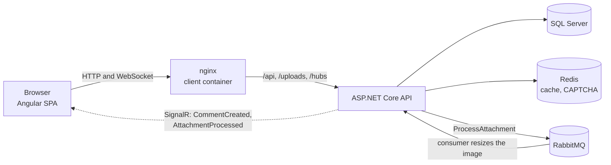
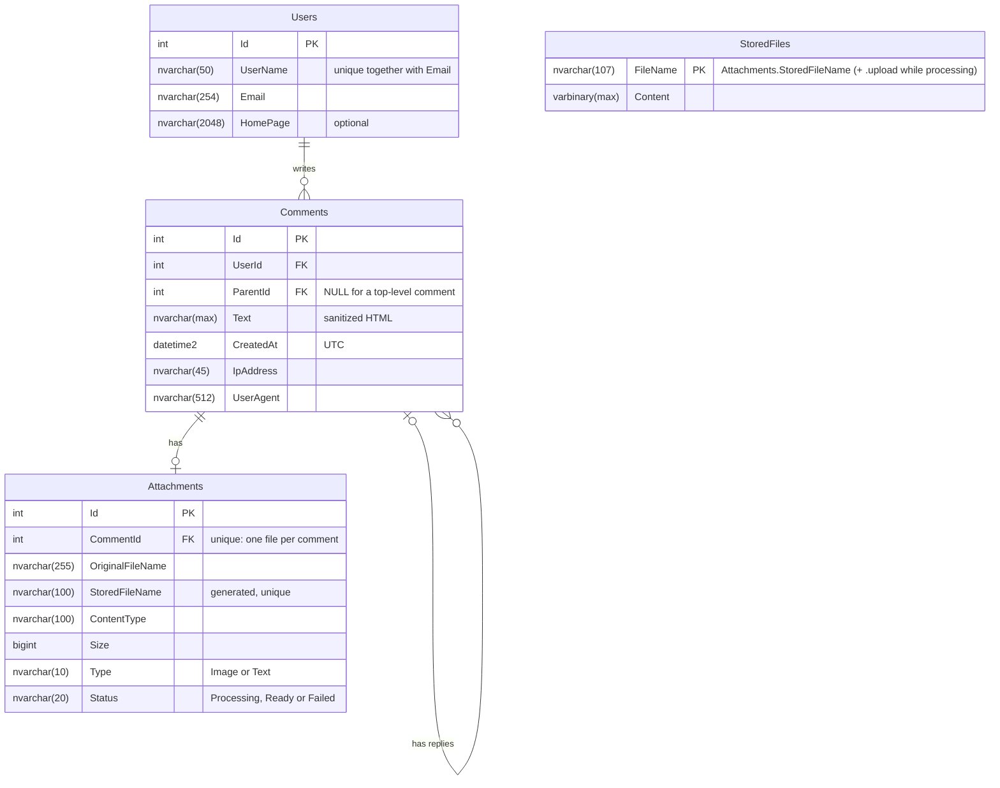

# CommentFlow: SPA "Comments"

A single-page application where visitors leave comments and reply to each other without a depth limit.
Built as a test assignment at the **Junior+** level: the Junior requirements plus a queue, a cache,
events and WebSocket.

**Stack:** .NET 10 (ASP.NET Core Web API, EF Core) · MS SQL Server · Angular 22 · Redis · RabbitMQ (MassTransit)
· MediatR · SignalR · nginx · Docker

## Contents

- [Features](#features)
- [Quick start with Docker](#quick-start-with-docker)
- [Local development](#local-development)
- [Configuration](#configuration)
- [How it works](#how-it-works)
- [Database](#database)
- [API](#api)
- [Security](#security)
- [Tests](#tests)
- [Project structure](#project-structure)
- [Known limitations](#known-limitations)

## Features

**Comment form**
- Fields: User Name (Latin letters and digits, required), E-mail (required), Home page (http/https URL, optional),
  CAPTCHA (picture with Latin letters and digits, required), Text (required).
- Validation on the client and, always, again on the server. Server errors are shown next to their fields.
- Only these HTML tags are allowed in the text: `<a href="" title="">`, `<code>`, `<i>`, `<strong>`.
  Every tag must be closed (valid XHTML); anything else is refused with a clear message.
- A toolbar with `[i]`, `[strong]`, `[code]`, `[a]` buttons wraps the selected text in the tag.
- **Preview** shows the comment exactly as it will be saved, without reloading the page (checked by the server).
- One file per comment: a JPG, GIF or PNG image (up to 5 MB, made proportionally smaller to fit 320×240)
  or a TXT file up to 100 KB. The file type is checked by its content, not by its name.
- The form opens in a window over the page: "Add a comment" for a new comment, "Reply" for an answer.
  The name, e-mail and home page are remembered between openings.

**Comments page**
- Top-level comments are shown in a table, sortable by User Name, E-mail and date in both directions.
  The default order is LIFO (newest first).
- 25 comments per page.
- Replies are shown as cascading cards under their comment, with no limit on depth.
- Attachments: image thumbnails and TXT files open in a lightbox with visual effects
  (fade-in, the picture grows in, smooth closing).
- Live updates: new comments of other people and processed images appear without reloading the page (SignalR).

**Data about the author** is stored with every comment to identify the client: name, e-mail, home page,
IP address and User-Agent.

## Quick start with Docker

Everything (SQL Server, Redis, RabbitMQ, the API and the web client) runs with one command.

**Requirements:** Docker Desktop (or Docker Engine with Compose v2) with at least 4 GB of memory for Docker
(SQL Server alone needs 2 GB). SQL Server images exist only for x86-64; on Apple Silicon they run through emulation.

1. Clone the repository:
   ```bash
   git clone https://github.com/SashaMaksyutenko/CommentFlow.git
   cd CommentFlow
   ```
2. Create the `.env` file with passwords from the example and change the values in it:
   ```bash
   cp .env.example .env            # PowerShell: Copy-Item .env.example .env
   ```
   The SQL Server password needs at least 8 characters with upper and lower case letters, digits and symbols,
   and must not contain `;` or `$`.
3. Build and start:
   ```bash
   docker compose up -d --build
   ```
   The first build downloads the base images and takes several minutes. The command returns when the API is ready;
   the API creates the database and applies the migrations itself.
4. Open **http://localhost:8080**.

| Address | What it is |
|---|---|
| http://localhost:8080 | The app (nginx serves Angular and passes `/api`, `/uploads`, `/hubs` to the API) |
| http://localhost:5080 | The API directly, only from this machine |
| http://localhost:15672 | RabbitMQ management page (login from `.env`), only from this machine |

Stop with `docker compose down` (the data stays in Docker volumes) or `docker compose down -v`
(also deletes the database and the uploaded files).

## Local development

**Requirements:** .NET SDK 10.0.201 or newer, Node.js 24 with npm, Docker (for SQL Server, Redis and RabbitMQ).

1. Create `.env` as in the quick start, then start only the services, not the API container:
   ```bash
   docker compose up -d sqlserver redis rabbitmq
   ```
2. Restore the local tools (`dotnet-ef`) and keep the connection strings in user secrets, outside the repository:
   ```bash
   dotnet tool restore
   dotnet user-secrets set "ConnectionStrings:CommentsDb" "Server=localhost,1433;Database=CommentsDb;User Id=sa;Password=<MSSQL_SA_PASSWORD from .env>;TrustServerCertificate=True" --project src/Comments.Api
   dotnet user-secrets set "ConnectionStrings:RabbitMq" "amqp://<RABBITMQ_USER>:<RABBITMQ_PASSWORD>@localhost:5672" --project src/Comments.Api
   ```
   Without the RabbitMQ connection string the API uses an in-memory queue.
3. Create the database and run the API (http://localhost:5063):
   ```bash
   dotnet ef database update --project src/Comments.Infrastructure --startup-project src/Comments.Api
   dotnet run --project src/Comments.Api --launch-profile http
   ```
4. Run the client (http://localhost:4200). `proxy.conf.json` passes `/api`, `/uploads` and `/hubs` to the API:
   ```bash
   cd client
   npm ci
   npx ng serve
   ```
   On the first run the Angular CLI may ask whether to share usage data; any answer works.

Don't run the local API and the `api` container at the same time: both would take image jobs from the same
RabbitMQ queue, and a job could go to the instance that doesn't have the file.
Use `docker compose stop api client` to go back from the full Docker setup to local development.

A new migration:
```bash
dotnet ef migrations add <Name> --project src/Comments.Infrastructure --startup-project src/Comments.Api --output-dir Persistence/Migrations
```

## Configuration

Settings come from `appsettings.json`, user secrets (development) and environment variables
(`docker-compose.yml`, where `:` is written as `__`). No secrets are kept in the repository.

| Setting | Default | Meaning |
|---|---|---|
| `ConnectionStrings:CommentsDb` | — (required) | SQL Server connection string |
| `ConnectionStrings:Redis` | `localhost:6379` | Redis; empty = in-memory cache |
| `ConnectionStrings:RabbitMq` | — | RabbitMQ `amqp://` address; empty = in-memory queue |
| `FileStorage:Provider` | `Disk` | Where uploaded files are kept: `Disk` (the folder below) or `Database` (the `StoredFiles` table, for hosts whose disk is wiped on restart) |
| `FileStorage:RootPath` | `uploads` | Folder for uploaded files when the provider is `Disk` (a Docker volume in Docker) |
| `Database:MigrateOnStartup` | `false` | Apply EF Core migrations when the API starts (`true` in Docker) |
| `ForwardedHeaders:Enabled` | `false` | Take the visitor's IP from `X-Forwarded-For` (`true` behind nginx in Docker) |
| `RateLimits:CaptchaPerMinute` | `30` | CAPTCHA pictures per IP per minute |
| `RateLimits:CommentsPerMinute` | `10` | New comments per IP per minute |
| `RateLimits:PreviewPerMinute` | `60` | Previews per IP per minute |

## How it works



**Layers** (dependencies point inwards):

| Project | Contents |
|---|---|
| `Comments.Domain` | Entities `User`, `Comment`, `Attachment` and their rules |
| `Comments.Application` | Services, DTOs, validation, the HTML sanitizer, interfaces, MediatR events |
| `Comments.Infrastructure` | EF Core, repositories, Redis cache, CAPTCHA, file storage, Magick.NET, MassTransit |
| `Comments.Api` | Controllers, SignalR hub, error handling, rate limits, composition root |

**Creating a comment:**
1. The text is sanitized and checked (allowed tags only, all tags closed).
2. The CAPTCHA is checked on the server and removed, so one picture works only once.
3. The author is found by name + e-mail or created, the comment is saved with the IP and User-Agent.
4. An image is saved as it was uploaded with the status `Processing`, and a message goes to RabbitMQ.
   A TXT file is ready at once.
5. The `CommentCreated` event (MediatR) clears the cached comment pages and sends the comment to all browsers
   through SignalR.
6. The consumer makes the image fit 320×240 and marks it `Ready` (or `Failed`). The `AttachmentProcessed` event
   clears the cache again and tells the browsers, so the thumbnail appears by itself.

**Cache:** pages of top-level comments are kept in Redis for 5 minutes. Every new comment or processed image changes
a version key, so old pages are never shown. CAPTCHA answers are kept in Redis for 5 minutes.

## Database

MS SQL Server, schema created by EF Core migrations
([src/Comments.Infrastructure/Persistence/Migrations](src/Comments.Infrastructure/Persistence/Migrations)).



`StoredFiles` holds the files themselves when they are kept in the database instead of on disk
(for hosts whose disk is wiped on restart). It is linked to `Attachments` by the file name, not by a foreign key.

Schema files in [docs/database](docs/database):
- [schema.mysql.sql](docs/database/schema.mysql.sql): for **MySQL Workbench**. Open it with
  *File → Import → Reverse Engineer MySQL Create Script…* and tick *Place imported objects on a diagram*.
  The same tables, keys and indexes with the nearest MySQL types.
- [schema.sqlserver.sql](docs/database/schema.sqlserver.sql): the real SQL Server script generated from the migrations.

## API

| Method | Path | What it does |
|---|---|---|
| GET | `/api/comments?page=1&sortBy=createdAt&sortDirection=desc` | Top-level comments, 25 per page. `sortBy`: `createdAt`, `userName`, `email`; `sortDirection`: `asc`, `desc` |
| GET | `/api/comments/{id}/replies` | The whole tree of replies to a comment |
| POST | `/api/comments` | New comment or reply, `multipart/form-data`: `userName`, `email`, `homePage`, `text`, `parentId`, `captchaId`, `captchaAnswer`, `file` |
| POST | `/api/comments/preview` | `{ "text": "..." }` → the text as it would be saved, or the reason it is refused. Nothing is saved |
| GET | `/api/captcha` | A new CAPTCHA: `{ "id": "...", "image": "data:image/png;base64,..." }` (the answer never leaves the server) |
| GET | `/uploads/{file}` | Uploaded files (only `.jpg`, `.png`, `.gif`, `.txt`) |
| GET | `/health`, `/health/ready` | The API is up / the API can reach the database |

Validation errors come back as `400` with field names (`UserName`, `Text`, `CaptchaAnswer`, `File`, ...),
too many requests as `429`.

**SignalR hub** `/hubs/comments` sends `CommentCreated(comment)` and `AttachmentProcessed(commentId, attachment)`.

## Security

- **XSS:** the server keeps only `<a href title>`, `<code>`, `<i>`, `<strong>`, allows only `http`/`https` links
  and refuses everything else. Angular sanitizes the HTML once more before showing it; user names, file names
  and home pages are only ever shown as text.
- **SQL injection:** all database access goes through EF Core with parameters, no SQL is built from strings.
- **Validation** on the client and always on the server.
- **CAPTCHA:** checked on the server, the answer is never sent to the browser, each picture works once
  and lives 5 minutes.
- **Files:** the type is checked by the content, sizes are limited, files are stored under generated names
  and served only with the four allowed types (`X-Content-Type-Options: nosniff`).
- **Rate limits** per IP for CAPTCHA, new comments and previews. Behind nginx the real visitor IP is taken from
  `X-Forwarded-For`, which nginx overwrites, so it can't be faked.
- **Secrets** only in `.env` and user secrets, both outside Git. The API runs as a non-root user in its container.

## Tests

```bash
dotnet test                          # backend: xUnit, the API is started in memory
cd client && npx ng test --watch=false   # client: Vitest
```

## Project structure

```
src/
  Comments.Api/             controllers, SignalR hub, error handling, rate limits, Dockerfile
  Comments.Application/     services, DTOs, validation, sanitizer, events
  Comments.Domain/          entities
  Comments.Infrastructure/  EF Core and migrations, repositories, Redis, RabbitMQ, files, images, CAPTCHA
tests/
  Comments.Tests/           backend tests
client/                     Angular app, nginx.conf and Dockerfile of the client image
docs/database/              database schema files
docker-compose.yml          SQL Server, Redis, RabbitMQ, API, client
```

## Known limitations

- **Live updates after a lost connection:** SignalR reconnects by itself, but comments written while the connection
  was lost are not loaded afterwards; a page reload shows them.
- The author's own comment comes twice (from the form and through SignalR); it only causes one extra table load.
- **One API instance:** rate limit counters live in the API process and SignalR has no backplane. Several instances
  would need shared counters and a Redis backplane.
- **SQL Server port 1433** is published on all network interfaces in `docker-compose.yml` for local development tools.
  On a public server remove that port mapping (the API reaches SQL Server inside the Docker network).
- The API image is about 800 MB on disk: Magick.NET brings native libraries for every platform.
